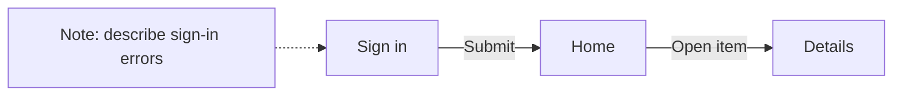

# TheBoard

An offline-first canvas for application user flows: screenshots, directed
transitions, and notes. Bring your own storage instead of relying on a
TheBoard data server.

[Open TheBoard](https://ehlyzov.github.io/theboard/).
Boards stay in browser storage. To move an existing localhost board to this
hosted origin, export its ZIP locally and import it in the hosted app.

## Product direction

Store boards in a folder in your own GitHub repository or in browser storage.
Move complete boards between browsers using portable archives. Working with
locally available data should not depend on a network connection; GitHub
exchange requires connectivity and must not interrupt local work.

## Current capabilities

Upload PNG/JPEG/WebP screenshots, edit titles, arrange screens, connect them
with directed arrows, and write notes. Pan and zoom the canvas. Deleting a
screen also removes its transitions.

The current increment adds independent browser boards in IndexedDB, labeled
transitions, and ZIP import/export. Import creates a new board; existing boards
are not replaced. Keep exported archives as backups: browser data can be
removed by clearing site data. GitHub synchronization and offline application
startup are still pending. Images are processed locally and are not uploaded.
See the [MVP brief](docs/product/mvp-brief.md) for requirements and decisions.

Use the marker icon in a screen header to annotate that screenshot, or hover
the screen and press B. The active marker shows a nearby size slider and
percentage; brackets also change brush size. Enter completes a mask; its
preview stays visible while you write or choose a linked note.
Navigation hints appear below the canvas in the status area.

The current editing increment adds brush masks linked to ordinary notes, eight
pastel note colors, four-side magnetic note docking, focus navigation and saved viewport
preferences. The sidebar can switch between automatic ELK arrangement and
manual placement. Enabling automatic layout warns before resetting manual
positions; cancelling preserves the arrangement. Docked notes remain editable
and portable, and move with their screen. Automatic layout also keeps
undocked mask-linked notes near their primary source without changing docking
or adding navigation edges. Hover a transition label to reveal
its dashed leader and highlight its arrow and endpoints. Focus computes a
temporary compact layout for the selected screen and its destinations; it is
not saved or exported. Leaving focus restores the original placement and
normal-view viewport. Content edits still save normally.

## Run and verify

Requires Node.js 24 or newer.

```sh
npm ci
npm run dev
```

Open the Vite URL. Rename screens below their images. Drag objects by their
header. Connect the right handle of one screen to the left handle of another,
using drag or two clicks. Select an edge and press Delete to remove it. Escape
cancels a pending connection. Transition labels can be edited in the sidebar.

For a stable local demonstration, use the production preview:

```sh
npm run build
npm run preview -- --port 4173 --strictPort
```

```sh
npx playwright install chromium
npm test
```

Linux CI installs the browser with `--with-deps`. Tests use synthetic images
under `tests/fixtures/`; HTML results are in `playwright-report/`.
Images are limited to PNG/JPEG/WebP, 10 MB and 40 megapixels each.

## GitHub Pages

`npm run build:pages` creates `dist-pages/` with the `/theboard/` base path;
`npm run test:pages` checks that production artifact on a separate local port.
The ordinary development/root build keeps `/` as its base.

The Actions workflow runs the existing editor suite and the Pages production
checks on pull requests. On `main`, deployment waits for both jobs to pass and
publishes only the tested static artifact. It includes app/legal assets, never
browser board data. See [publication verification](docs/work/W010-license-pages.md).

## License

Project code is licensed under the [Apache License 2.0](LICENSE), with attribution
in [NOTICE](NOTICE). Third-party components retain their own licenses; see
[third-party notices](THIRD_PARTY_NOTICES.md). Production builds include
`LICENSE.txt`, `NOTICE.txt` and a complete `THIRD_PARTY_NOTICES.txt` bundle.

## Declarative boards for agents

A board is a versioned `board.json` with stable IDs, explicit coordinates,
notes, and labeled directed edges, plus ordinary image files in `assets/`.
No browser automation is needed to author the data. See
[the format and archive commands](docs/board-format.md).

```sh
python3 scripts/board_archive.py pack /path/to/board-folder /path/to/board.zip
python3 scripts/board_archive.py unpack /path/to/board.zip /path/to/new-folder
```

## First target flow

Upload named screenshots, arrange them, connect steps, add notes, save the
board, and reopen it without losing content.



This diagram illustrates the product purpose; it is not a runtime screenshot.

## Project workflow

The [layout research and algorithm proposal](docs/research/board-layout.md)
compares directed graph layout with chip placement and records a reproducible
synthetic ELK probe. Automatic layered placement is integrated in the editor;
the proposed obstacle-aware fixed-node router remains pending. After manual
node dragging, the editor reconnects edges with its manual routing rather than
silently moving other nodes.
An [isolated interactive example generator](docs/research/layout-example.md)
can demonstrate the proposed layout on a local board folder without changing
the editor or its saved boards.

Small sequential changes: scenarios → checks → implementation → independent
technical review → functional acceptance. Read [CONTRIBUTING.md](CONTRIBUTING.md),
the [task queue](docs/work/tasks.md), and the [initial workflow pilot](docs/work/W001-workflow.md).
Repository documentation is English; communication with the owner is Russian.

To attach a note, drag its magnet to a highlighted screen side, or click the
magnet and then click a side. Escape cancels. Clicking an attached note's magnet
detaches it; the note text and color remain. The side targets also support Tab
and Enter/Space.

Masks are owned by their notes: deleting the last associated note also removes
the mask. Shared masks survive while another linked note exists. Top/bottom
docked notes match the screen core width, excluding side notes. Select a mask
to emphasize all its note connections. Notes no longer have a completion UI.
