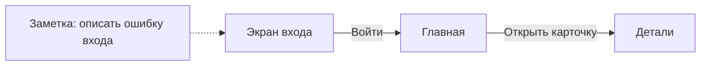

# TheBoard

Доска для визуального описания пользовательских потоков приложения: экраны,
стрелки переходов и заметки. Первый целевой результат — MVP для UFD
(предварительная расшифровка: User Flow Diagram).

## Идея

Доска типа Miro без собственного серверного хранилища пользовательских данных.
Пользователь выбирает, где хранить доску:

- в папке своего GitHub-репозитория;
- в браузерном хранилище с экспортом и импортом файла-архива.

Offline-first: работа с доступной локально доской не должна зависеть от сети.
Обмен с GitHub требует подключения и не должен мешать локальной работе.

## Статус

Реализован первый редактор: загрузка PNG/JPEG/WebP с названиями, перемещение
экранов, направленные стрелки и текстовые заметки. Есть масштабирование
и навигация. Удаление экрана удаляет связанные стрелки.

**Доска пока существует только в открытой вкладке.** Постоянное хранение,
офлайн-перезапуск, архив и GitHub ещё не реализованы. Изображения не
отправляются на сервер. Требования и следующие возможности описаны в
[продуктовом черновике](docs/product/mvp-brief.md).

## Первый целевой поток

Загрузить скриншоты с названиями, разместить их на доске, соединить стрелками
и добавить заметки. Сохранить доску и снова открыть её без потери содержимого.



Это иллюстрация назначения продукта, а не снимок работающего приложения.

## Ведение проекта

Работа идёт небольшими последовательными изменениями: сценарии → проверки →
реализация → отдельная техническая проверка → функциональная приёмка.
Правила — в [CONTRIBUTING.md](CONTRIBUTING.md), состояние работы — в
[очереди задач](docs/work/tasks.md). [Выбор подхода и первый пробный проход](docs/work/W001-workflow.md).

## Запуск и проверки

Нужен Node.js 24 или новее.

```sh
npm ci
npm run dev
```

Откройте адрес из вывода Vite. Загрузите несколько изображений; подписи под
экранами редактируются. Перетаскивайте объекты за верхнюю полоску. Для стрелки
перетащите правую точку экрана к левой точке другого или нажмите их по очереди.
Выделенную стрелку можно удалить клавишей Delete. Escape отменяет создание связи.

```sh
npm run build
npx playwright install chromium
npm test
```

В Linux CI установка браузера выполняется с `--with-deps`. Тесты используют
синтетические изображения из `tests/fixtures/`. HTML-отчёт: `playwright-report/`.
Файлы ограничены PNG/JPEG/WebP, 10 МБ и 40 мегапикселями на изображение.
