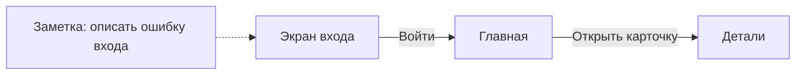

# TheBoard

Доска для визуального описания пользовательских потоков приложения: экраны,
стрелки переходов и заметки. Первый целевой результат — MVP для UFD
(предварительная расшифровка: User Flow Diagram).

## Идея

Доска типа Miro без собственного серверного хранилища пользовательских данных.
Пользователь выбирает, где хранить доску:

- в папке своего GitHub-репозитория;
- в браузерном хранилище с экспортом и импортом файла-архива.

Offline-first: работа с доступной локально доской не должна зависеть от сети.
Обмен с GitHub требует подключения и не должен мешать локальной работе.

## Статус

Новый проект на стадии продуктового проектирования. Приложение ещё не реализовано.
Требования и предложения для первого MVP описаны в
[продуктовом черновике](docs/product/mvp-brief.md).

## Первый целевой поток

Показать последовательность экранов приложения, переходы между ними и заметки,
сохранить доску и снова открыть её без потери содержимого.

Это иллюстрация назначения продукта, а не снимок работающего приложения.
